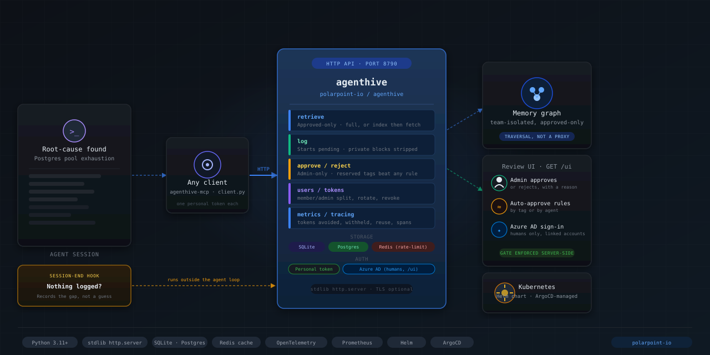
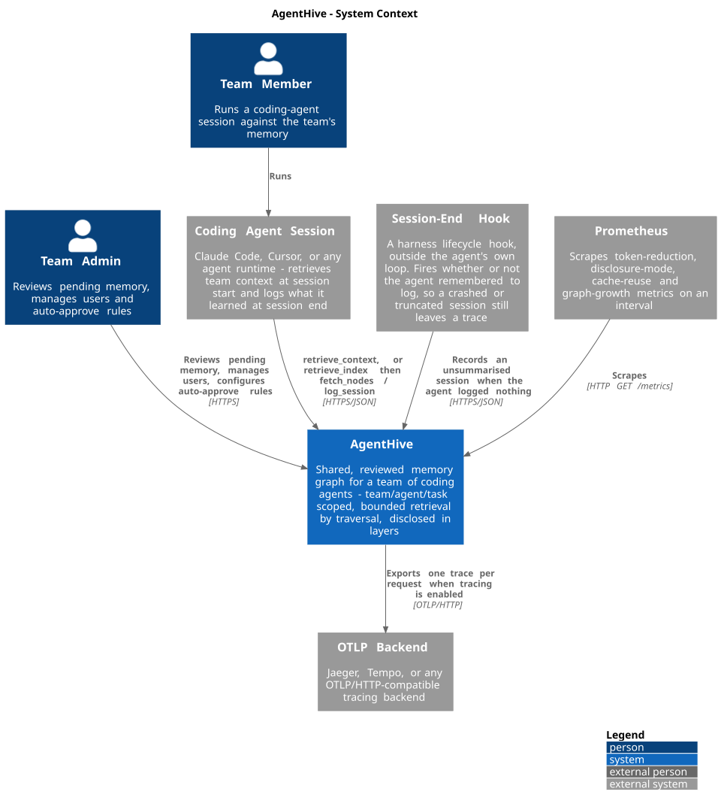
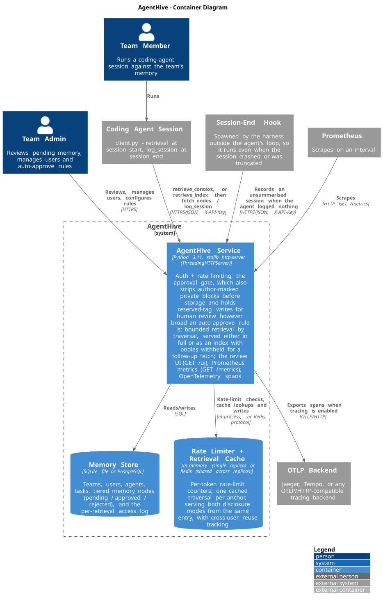
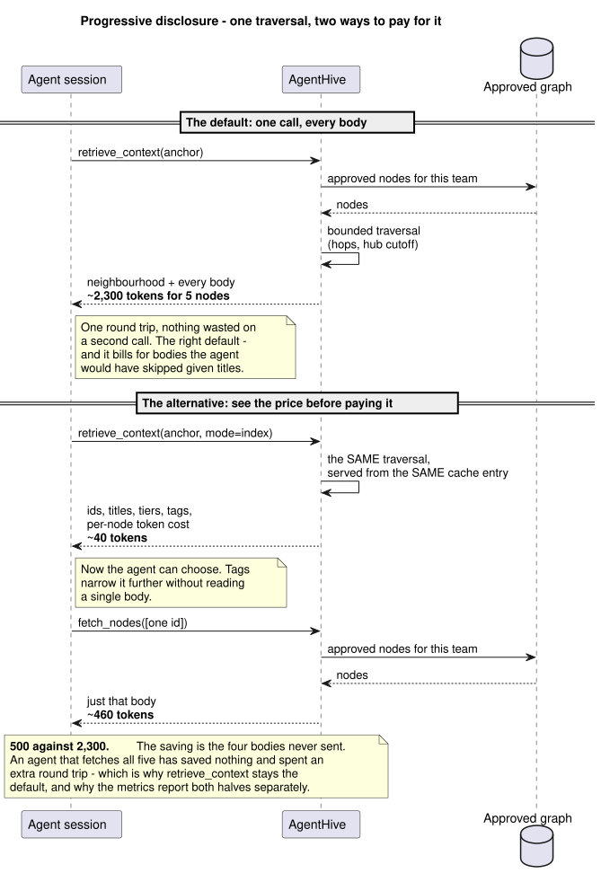
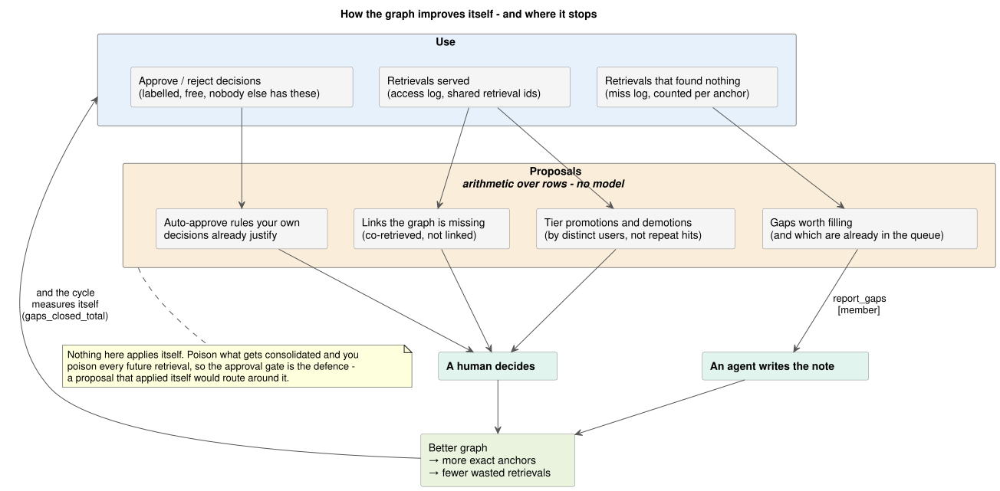

# AgentHive



A shared, reviewed memory graph for a team of coding agents: a
team/agent/task graph with retrieval-by-traversal, and deliberately no
proxy that intercepts and enriches every single LLM request. See
[`ADR.md`](ADR.md) for the full reasoning.

**Onboarding a team?** [`ONBOARDING.md`](ONBOARDING.md) is the
step-by-step walkthrough - install, create a team, add teammates, wire
up an agent, review your first memory, and watch it work. This README is
the concept/reference doc; that one is the "do this, in this order" doc.

## Architecture

A System Context view (who and what talks to AgentHive) and a Container
view (what's inside it) - C4 model, source in
[`docs/diagrams/`](docs/diagrams/) as plain PlantUML against the
[C4-PlantUML](https://github.com/plantuml-stdlib/C4-PlantUML) stdlib, so
they render with any standard PlantUML toolchain and stay diffable in a
PR.





## What it actually does

- **Guardrail:** every memory an agent writes lands as `pending` (unless
  an admin has configured an auto-approve rule for it - see below). It is
  invisible to every other agent, in every session, until an admin
  approves it.
- **Hive mind, scoped:** once approved, any user under the same team can
  retrieve it. Memory never crosses a team boundary - enforced at the
  query layer, verified in `tests/test_end_to_end.py`.
- **Per-user identity:** every call is made as a specific user's personal
  token (`admin` or `member` role), not one shared team secret. Tokens
  can be rotated or revoked individually. See `tests/test_auth.py`.
- **Auto-approve policy:** an admin can configure rules ("anything tagged
  `ci-noise`", "anything from agent X") that skip the review queue -
  useful once you know what your team actually rejects. Every
  auto-approved node still carries an audit trail (`auto_approved`,
  `rule_id`). See `tests/test_autoapprove.py`.
- **Token control, not token addition:** retrieval walks the approved
  graph outward from an anchor note (hub-cutoff traversal), returning a
  bounded neighborhood and its approximate token count. Nothing is
  injected automatically.
- **Disclosed in layers, not all at once:** the bounded neighborhood is
  still every body in it, including the ones a session would have
  skipped had it seen the titles first. `mode=index` returns the same
  traversal with bodies withheld - ids, titles, tiers, tags and a
  per-node token cost - and `POST /memory/fetch` returns only the bodies
  actually wanted. See "Progressive disclosure" below for when this is
  and is not a good trade.
- **Two calls, not every call:** an agent session calls `retrieve_context`
  once at the start and `log_session` once at the end. There is no proxy
  sitting in front of your LLM traffic.
- **A backstop for the sessions that never call either:** `log_session`
  runs only when the agent chooses to call it, and the sessions most
  worth recording are the ones that crashed, hit a context limit, or
  ended when someone closed the terminal. A harness lifecycle hook fires
  regardless and records that a session went unsummarised, so the gap is
  visible in the review queue instead of silent. It is a backstop, not a
  second writer - when the agent logged properly, the hook writes
  nothing. See
  [agenthive-mcp](https://github.com/polarpoint-io/agenthive-mcp)'s
  `agenthive-log`.
- **SQLite or Postgres:** SQLite by default (zero setup); set
  `DATABASE_URL` to a `postgresql://` URL to run against Postgres once
  you need concurrent writers at real volume. Same schema, same code
  path either way.
- **A small review UI:** `GET /ui` serves a single-page app for approving/
  rejecting pending memory, managing auto-approve rules, managing users,
  and a per-team metrics snapshot - no separate build step, no separate
  deploy by default; it can also be split into its own container if you'd
  rather not expose it on the same origin as the API - see "Splitting the
  review UI into its own container" below.
- **Shared across replicas via Redis:** set `REDIS_URL` and the rate
  limiter and the retrieval cache both switch from in-memory (single
  replica only) to Redis-backed (shared across every replica). Required
  once you run more than one instance - see DEPLOYMENT.md.
- **Metrics that prove the pitch, not just assert it:** `GET /metrics`
  (Prometheus format) tracks tokens avoided by scoped retrieval, cache
  reuse across teammates (including *cross-user* reuse - direct evidence
  of shared, not per-agent, memory), and graph growth over time. See
  `observability/README.md` for what's actually measured and a starter
  Grafana dashboard.
- **TLS, natively or via a proxy:** set `AGENTHIVE_TLS_CERT_FILE` /
  `AGENTHIVE_TLS_KEY_FILE` to serve HTTPS directly, or terminate TLS in
  front (a reverse proxy, or the Helm chart's Ingress) as usual.
- **The whole journey, mapped:** set `OTEL_EXPORTER_OTLP_ENDPOINT` (or
  `AGENTHIVE_TRACING_CONSOLE=true` for zero infrastructure) and every
  request becomes an OpenTelemetry trace - the rate-limit check, the
  auth lookup, the cache lookup, the graph traversal, the approval gate
  itself - not just a counter that it happened. `client.py` propagates
  trace context to the server and can link a whole agent session
  (retrieve + log) into one trace with `traced_session(...)`. Off by
  default, zero cost when unset. See `tracing.py` and `ONBOARDING.md`'s
  "Watch it work" step.
- **Docker and Helm, the same shape as the rest of polarpoint-io:**
  `docker compose up` for a single host; for Kubernetes, `helm install`
  against the chart in `helm/agenthive/` (SQLite+1 replica or
  Postgres+N replicas, with Redis, Ingress/TLS, Prometheus scraping, and
  tracing all wired through chart values). Images publish to
  `ghcr.io/polarpoint-io/agenthive` and then the chart to
  `oci://ghcr.io/polarpoint-io/charts`, from one semantic-release version
  on `main`, the same release pipeline used
  across the org (see `.github/workflows/`). `docker compose --profile
  jaeger up` gives you a trace-browsing web UI in one command.

## Where the savings actually come from

Four mechanisms, each with the metric that proves it and the case where
it does not help. There is a slide deck covering this in
[`docs/deck/`](docs/deck/) (`make html`), and the two flows below are
drawn in [`docs/diagrams/`](docs/diagrams/).



| Mechanism | Saves | Proven by | Does nothing when |
|---|---|---|---|
| Bounded traversal | Sending a whole team's history to answer one question | `tokens_avoided_total` | The anchor matches nothing — then it saved you nothing and cost a round trip |
| Progressive disclosure | The bodies an agent would have skipped | `index_tokens_withheld` − `fetch_tokens_served` | The agent fetches everything it indexed |
| Shared retrieval cache | A second teammate re-walking the same graph | `cross_user_cache_hits_total` | One person works alone |
| Gap reporting + the backstop hook | Rediscovering what a teammate already learned | `gaps_closed_total` | Nobody reads the queue, so nothing gets approved |

The right-hand column is the point. Every one of these has a case where
it is neutral or slightly negative, and the metrics are built to show
that rather than hide it — see
[`observability/README.md`](observability/README.md), which carries the
queries for each failure shape.

### The expensive failure is a miss, not a big response

Tokens are the visible cost. A retrieval that returns **nothing** costs
more: a round trip, then the work done from scratch, then frequently a
note logged that duplicates one already in the graph under a different
title. Three costs from one failed lookup.

`report_gaps` and `agenthive_anchor_resolution_total` exist to make that
countable. A rising `fallback` share means titles no longer match how
people phrase things, which is a naming problem that no amount of `hops`
or `hub_cutoff` tuning will fix.



## Running it

```bash
python3 server.py --port 8790 --db agenthive.db
```

That's the whole deploy for SQLite. One process, one file. For Docker,
Kubernetes (Helm), Postgres, Redis, TLS, systemd, and reverse-proxy
setups, see [`DEPLOYMENT.md`](DEPLOYMENT.md) and
[`helm/agenthive/README.md`](helm/agenthive/README.md).

```bash
docker compose up -d --build          # single host, SQLite
helm install agenthive helm/agenthive # Kubernetes
```

## Setting up a team

```python
from client import TeamMemoryClient, create_team

data = create_team("http://127.0.0.1:8790", "Platform Team")
team, owner = data["team"], data["user"]
# owner["token"] is shown ONLY here - save it somewhere real, there is
# no recovery flow. It's the team's first admin user.

admin = TeamMemoryClient("http://127.0.0.1:8790", owner["token"], team["id"])

# Give each agent-running teammate their own token, don't share the admin's:
engineer = admin.create_user("alice", role="member")
# engineer["token"] -> hand this to Alice's agent config, not the admin token

agent = admin.create_agent("bug-fix engineer", description="fixes prod incidents")
task = admin.create_task("Q4 incident backlog")
```

## What an agent session actually calls

At the start of a session (in a `CLAUDE.md` / `.cursor/rules` instruction):

```python
from client import TeamMemoryClient

client = TeamMemoryClient("http://127.0.0.1:8790", engineer_token, team_id)
context = client.retrieve_context("Postgres connection pool exhaustion", hops=2)
# context["neighborhood"] -> bounded list of approved memory nodes
# context["approx_tokens"] -> what this actually costs before you send it
```

At the end of a session:

```python
client.log_session(
    title="Postgres connection pool exhaustion",
    body="Root cause: pgbouncer max_client_conn too low. Fix: raised to 400.",
    agent_id=agent["id"],
    task_id=task["id"],
    tags=["postgres", "incident"],
    links=["Pgbouncer Runbook"],
)
```


This writes a node that starts `pending`, unless it matches an
auto-approve rule.

## Hooking up Cursor / Claude Code via MCP

The instruction-block approach above works anywhere, but Cursor and Claude
Code can also discover `retrieve_context` and `log_session` as native
tools over [MCP](https://modelcontextprotocol.io) - no `CLAUDE.md` /
`.cursor/rules` prose needed, the agent just sees them in its tool list.

That MCP server lives in its own repo,
[agenthive-mcp](https://github.com/polarpoint-io/agenthive-mcp) - a thin
local wrapper with its own dependency and release cadence, unrelated to
this service's own container image, Helm chart, or CI matrix. See that
repo's README for setup.

## Progressive disclosure

`retrieve_context` answers "what is near this anchor, and here is all of
it" in one round trip. That is the right default, and it stays the
default. But it bills the caller for every body in the neighborhood,
including the ones they would have skipped given the titles first.

Two extra layers, for when that matters:

```python
index = client.retrieve_index("Postgres connection pool exhaustion")
for node in index["neighborhood"]:
    print(node["id"], node["title"], node["tags"], node["approx_tokens"])

# Then pay only for what's worth reading. One call, not one per id.
bodies = client.fetch_nodes([index["neighborhood"][0]["id"]])
```

`retrieve_index` runs the identical traversal and withholds the bodies.
`fetch_nodes` returns the ones you ask for; ids that are pending,
rejected or another team's come back in `missing` rather than as an
error, because that is the approval gate working.

**When it is worth it:** a wide neighborhood, or a session that needs
one specific thing out of many. **When it is not:** a small
neighborhood, or a session that will read most of what comes back. Two
round trips to save a few hundred tokens is a worse deal than one, and
an agent that fetches every id it indexed has saved nothing and spent an
extra call. `retrieve_context` is still the default for exactly that
reason.

The index is a projection of the full result rather than a cheaper
second query, so one cache entry serves both modes - including
cross-user cache hits, which are the evidence that this is shared rather
than per-agent memory. Splitting the cache by mode would have halved
that figure for no gain.

**The metrics do not flatter this.** `agenthive_tokens_avoided_total` is
computed against the full neighborhood in both modes. Defining it
against bytes actually sent would make the headline number jump the
moment a caller switched mode, and jump again when it fetched the bodies
back. The index/fetch pair is counted separately so the net can be
worked out instead of assumed - see `observability/README.md`, which is
explicit that if the difference trends to zero the layer is costing a
round trip and buying nothing.

## Reserved tags

Tags are free-form, but four names carry meaning: `decision`, `bugfix`,
`security_alert`, and `sensitive`. They are returned by `retrieve_index`,
so a session can filter on them without reading a body, and they are
filterable at review time.

`security_alert` and `sensitive` can never be auto-approved. The check
runs at write time rather than inside the rule matcher, so a rule that
matched on `agent_id` is caught too - a tag-only check in the matcher
would have waved that through. An admin can still approve such a node by
hand in a second; nothing approves it by accident.

## Withholding content from a memory node

Anything wrapped in `<private>...</private>` is stripped from a node's
title and body **before storage**, leaving a visible `[redacted]`
marker.

This is not a replacement for the approval gate. The gate is a human
reading the thing, which means it catches a leaked credential only after
it is already in the database and rendered in an admin's browser. This
never writes it down. Both controls, not either.

```python
client.log_session(
    title="Rotated the signing key",
    body="Fixed by rotating. Old value was <private>REDACT_ME</private>.",
)
# stored as: "Fixed by rotating. Old value was [redacted]."
```

An unclosed `<private>` strips to the end of the text on purpose.
Treating a malformed tag as literal text would store exactly the content
the author was trying to withhold, which is the wrong way round for a
failure nobody will notice.

## What the graph learns about its own use

AgentHive has always recorded the signals needed to improve itself and
never acted on any of them. `memory_access_log` knows which nodes get
served together and to whom. `retrieval_misses` knows what people keep
looking for and never find. Every approve and reject is a
human-labelled example of what this team wants kept. All of it used to
terminate in a dashboard.

`insights.py` turns those signals into **proposals**. Four of them:

```python
client.report_gaps()        # [member] anchors that keep missing
admin.suggest_links()       # nodes retrieved together but not linked
admin.suggest_tiers()       # promote/demote by actual use, plus a prune list
admin.suggest_rules()       # auto-approve rules your own decisions justify
```

### Gaps

The only one at member level, because it is the one that changes what an
agent does. Called at session start next to `retrieve_context`, it says
what this team has searched for repeatedly and come back empty on - so a
session that happens to learn one of those things knows its
`log_session` closes a standing gap. Entries marked `awaiting_review`
already have an answer sitting unapproved, where the fix is a human
clearing the queue rather than anyone writing it twice.

### Links

Retrieval here is traversal over links, so a missing edge is a node that
cannot be reached from an anchor it genuinely relates to. Nodes the same
retrievals keep returning together, and that are not linked, are
candidate edges. Pairs already linked in either direction are dropped,
since adjacency is built bidirectionally.

### Tiers

`tier` has been on every node since the first schema and has never been
anything but its default. It now records use: three different teammates
and five retrievals earns `L3`, any reuse at all earns `L2`. Computed
from current stats rather than ratcheted, so a node that was useful last
quarter and is dead now drops back on its own. That matters - a graph
that only grows gets quietly worse at answering, and the failure mode is
a slightly worse neighbourhood rather than an error anybody notices.
`stale` lists nodes approved long ago and never once retrieved.

`POST /teams/{id}/tiers/apply` is the only endpoint in this group that
writes, it is admin-triggered, and tier is metadata about how a node is
*used* - never a word of its content.

### Rules

An auto-approve rule currently has to be written by hand. Your gate has
been generating the evidence for them all along: a tag approved 40 times
out of 40 is a rule somebody should have written months ago. `rules` are
candidates to create; `noisy` is the inverse, naming agents whose writes
are mostly rejected, where the fix is upstream in that agent's prompt
rather than anywhere in the review queue.

Reserved tags are never proposed however good the record. A
`security_alert` gets a human regardless of how routine it has looked so
far, and a mined rule overriding that would quietly undo the guardrail.
Auto-approved nodes are excluded from the evidence entirely, because
counting a rule's own output as justification would let one hasty rule
license its successors.

### Does any of it work?

`GET /metrics` answers that, including when the answer is no.
`agenthive_gaps_closed_total` counts anchors that used to return nothing
and now return something, which is the loop doing its job;
`agenthive_proposals_raised_total` climbing while
`agenthive_tier_changes_applied_total` stays flat is the loop being
ignored, which is the likelier failure and the one that errors nowhere.
See [`observability/README.md`](observability/README.md) for the queries
and for what these numbers deliberately do not claim.

A closed gap also stops being a gap: once an anchor returns something,
its miss row is cleared, so `report_gaps` stops asking anyone to write a
note that now exists.

### Two constraints this layer is built around

**No model.** Everything here is arithmetic over rows. Nothing calls an
LLM, because the moment AgentHive calls one it becomes the proxy its
[`ADR.md`](ADR.md) exists to avoid, and memory that rewrites itself with
a model is memory you can no longer audit.

**Proposals, not actions.** Nothing applies itself. That is not
timidity: self-improving memory is a known attack surface, since
poisoning what gets consolidated poisons every future retrieval. The
approval gate is the defence, and a suggestion that applied itself would
route around the one control that makes this system trustworthy.

## Reviewing pending memory

Open `http://127.0.0.1:8790/ui` in a browser (or wherever you've deployed
it - see "Splitting the review UI into its own container" below), enter
the base URL, team ID, and an **admin** token, and approve/reject from
there - or script it:

```python
pending = admin.list_pending()
for node in pending["pending"]:
    print(node["id"], node["title"], node["body"][:80])

admin.approve(node_id)
# or
admin.reject(node_id, reason="not ready, needs discussion")
```

## Automating the review gate

Only half of it, and deliberately.

**Rejection is safe to automate.** Its failure mode is a lost note
somebody can write again. **Approval is not.** Its failure mode is a bad
memory visible to every agent on the team for as long as it stays
approved, and poisoning what gets consolidated poisons every future
retrieval. So: reject liberally, approve only on a rule a human wrote.

Nothing is deleted either way. An auto-rejected node keeps its row and
its reason, `GET /teams/{id}/memory/rejected` shows them, and an admin
can still approve one afterwards. Recoverability you cannot reach would
be deletion with extra steps.

### Deterministic rejection

Two checks, no rule needed:

| Check | Default | Setting |
|---|---|---|
| Identical title **and** body to something already approved | on | `AGENTHIVE_AUTO_REJECT_DUPLICATES` |
| Body shorter than N characters | off | `AGENTHIVE_AUTO_REJECT_BODY_UNDER` |

Duplicates default on because identical content is unambiguously
redundant. The key is title *and* body on purpose: an agent relogging a
title with a better body is an improvement, and treating that as a
duplicate would discard the improvement and keep the weaker note.

Trivial bodies default off because "too short to keep" is a judgement
that belongs to a team, not to this default.

### Reject rules

```python
admin.create_auto_reject_rule(match_agent_id=agent["id"],
                              reason="prompt needs fixing")
admin.create_auto_reject_rule(match_tag="scratch")
```

Same shape as auto-approve rules, opposite direction. When a node
matches both, **rejection wins** - that is a configuration error either
way, and resolving it toward "does not enter the graph" is the
conservative reading.

Reserved tags are beyond automation in *both* directions: auto-approving
a `security_alert` hides it, auto-rejecting one discards it, and both
are worse than a slow queue.

### Triage

The queue is otherwise a flat list by age, which is the wrong order the
moment it has anything in it.

```python
admin.list_pending_triaged()
```

Sorts by what is *waiting* on each node, annotating each with
`closes_gap` and `gap_miss_count` - how many times somebody searched for
this and found nothing. A node answering an anchor missed nine times
comes ahead of forty older backstop nodes.

Everything still comes back; only the order and the annotations change,
and the default ordering is untouched for existing callers. Automating
the **order** makes a reviewer faster. Automating the **verdict** is the
part worth refusing.

### What is deliberately not here

No LLM reviewer. The moment a model decides what enters shared memory,
the gate becomes one model judging another's output with no human in the
loop, and memory stops being something you can audit. `ADR.md` covers
why that line is where it is.

Read `agenthive_review_latency_seconds` and
`agenthive_oldest_pending_age_seconds` before reaching for any of this.
A p50 of minutes with near-total approval means the gate is already
ceremony and the answer is more auto-approve rules, not more automation.
An oldest-pending climbing into days means the answer is auto-reject
plus triage. Those are different problems.

## Auto-approve rules (admin only)

```python
admin.create_auto_approve_rule(match_tag="ci-noise")
# or: admin.create_auto_approve_rule(match_agent_id=agent["id"])

admin.list_auto_approve_rules()
admin.delete_auto_approve_rule(rule_id)
```

Any memory node written afterwards whose tags include `ci-noise` (or
whose `agent_id` matches) is approved immediately - it never enters the
pending queue.

## Managing users

```python
admin.create_user("bob", role="member")   # returns a token, shown once
admin.list_users()
admin.rotate_token(user_id)               # invalidates the old token
admin.revoke_user(user_id)                # locks the user out immediately
```

A `member` can log and retrieve memory, and manage agents/tasks. Only an
`admin` can review pending memory, manage users, or configure
auto-approve rules. Any user can rotate their own token.

## Azure AD sign-in (humans only)

Agents keep using their personal tokens exactly as above. Humans using the
review UI (`GET /ui`) can *also* sign in with Azure AD (Microsoft Entra
ID), once an admin sets four environment variables (see `.env.example`):

```bash
AGENTHIVE_AZURE_TENANT_ID=...
AGENTHIVE_AZURE_CLIENT_ID=...
AGENTHIVE_AZURE_CLIENT_SECRET=...
AGENTHIVE_AZURE_REDIRECT_URI=https://agenthive.yourcompany.com/auth/azure/callback
```

That last one must exactly match a Redirect URI registered on the Azure
AD App Registration. With all four set, `GET /ui` shows a "Sign in with
Microsoft" button.

Signing in with Microsoft never creates an AgentHive account by itself -
there is no auto-provisioning (see `ADR.md`'s "Authentication" section
for why). The first time someone signs in, they'll see their own Azure
object id and a message that no AgentHive user is linked yet; an admin
links it from the Users card (or `POST
/teams/{team_id}/users/{user_id}/link-azure {"azure_oid": "..."}`), and
from then on that person can sign in with Microsoft and lands as that
user, with a session that expires automatically
(`AGENTHIVE_AZURE_SESSION_TTL_SECONDS`, default 1 hour) rather than
living forever like an agent's token.

## Splitting the review UI into its own container

By default `GET /ui` on this same server is the whole story - nothing
else to deploy. If you'd rather not expose the review UI on the same
origin/port as the API (different ingress host, different scaling
profile, a stricter network policy on the API, etc.), `ui/Dockerfile`
builds it as its own static-file nginx container instead. The app's own
`/ui` route keeps working either way - this is an addition, not a
replacement, so you can run both during a migration or just pick one.

**Docker Compose:**

```bash
docker compose --profile split-ui up -d
# UI:  http://localhost:8080
# API: http://localhost:8790
```

**Helm:**

```yaml
ui:
  enabled: true
  apiUrl: https://agenthive.yourcompany.com        # pre-fills "Base URL"
  publicUrl: https://agenthive-ui.yourcompany.com   # this UI's own origin
  ingress:
    enabled: true
    host: agenthive-ui.yourcompany.com
```

Setting `ui.publicUrl` writes `AGENTHIVE_UI_URL` and
`AGENTHIVE_CORS_ORIGIN` into the API's config, so Azure AD sign-in
redirects land on the separate UI (instead of the API's own `/ui`) and
the API accepts cross-origin browser requests from it. Without Azure AD
configured, none of this is required - the UI's "Base URL" field already
supports pointing at a different API host manually, since `X-API-Key` is
a header you type in, never a cookie a browser sends automatically.

See `helm/agenthive/values.yaml`'s `ui.*` block for the rest of the
knobs (image, resources, ingress TLS, ...) - it mirrors the main chart's
own `image`/`ingress`/`resources` pattern.

## Testing

```bash
pip install -r requirements.txt
pytest
```

The suite spins up a real `server.py` per test ("test against a running
server, not mocks"), against an
isolated SQLite file by default. Set `DATABASE_URL` to also exercise the
Postgres backend, and `REDIS_URL_FOR_TESTS` for the Redis-backed rate
limiter/cache tests (`.github/workflows/build.yml` runs all three, then
smoke-tests the images and packages the chart).

`tests/test_retrieval_unit.py` proves the traversal algorithm in
isolation. `test_end_to_end.py`, `test_auth.py`, `test_autoapprove.py`,
`test_rate_limit.py`, `test_metrics_and_cache.py`, `test_redis_backends.py`,
`test_tls.py`, `test_tracing.py` and `test_oidc.py`
prove the properties
that matter for the design: the approval gate actually gates, team
isolation actually isolates, roles are enforced, revoked/rotated tokens
actually stop working, auto-approve rules actually match, the rate
limiter actually limits (in-memory *and* shared via Redis across two real
processes), a cache hit from a different user is counted as cross-user
reuse, the server actually serves HTTPS when TLS is configured, the write
-> review -> retrieve journey actually produces the right spans with a
shared trace id across a propagated call (using the zero-infrastructure
console exporter; real OTLP export to Jaeger was verified manually
during development - see `ADR.md`'s "Reliability and observability"
section), and Azure AD sign-in actually mints a working session only for
a linked user, against a real locally-generated RSA keypair and JWKS
endpoint rather than a mocked signature check. The MCP server's own
round-trip-through-approval-to-retrieval test lives in
[agenthive-mcp](https://github.com/polarpoint-io/agenthive-mcp)'s own
test suite now.

## Metrics: does this actually reduce token usage and get reused?

`GET /metrics` and the review UI's Metrics tab exist to answer that with
numbers instead of a claim:

```bash
curl http://127.0.0.1:8790/metrics | grep agenthive_tokens_avoided_total
curl -H "X-API-Key: $ADMIN_TOKEN" http://127.0.0.1:8790/teams/$TEAM_ID/metrics/summary
```

Import `observability/grafana-dashboard.json` into Grafana for the
trend view - tokens avoided over time, cache hit rate, cross-teammate
reuse, and graph growth. Read `observability/README.md` first: it's
explicit about what these numbers do and don't claim (this service
never calls an LLM, so "tokens avoided" means "not sent because
retrieval was scoped," not a real billing figure).

## Tracing: what actually happened for THIS call

Metrics answer "in aggregate, over time." Tracing answers "for the
retrieve_context call my agent just made, where did the 40ms go, and
what did the server actually do?" Turn it on with zero infrastructure
first:

```bash
AGENTHIVE_TRACING_CONSOLE=true python3 server.py --port 8790
```

Do a write + retrieve (see "What an agent session actually calls"
above) and watch the terminal - each finished span prints as one line
of JSON: the rate-limit check, the auth lookup, the cache lookup (hit or
miss), the graph traversal, the approval-gate write. For the real thing,
point it at Jaeger - a one-command trace-browsing web UI:

```bash
docker compose --profile jaeger up -d
export OTEL_EXPORTER_OTLP_ENDPOINT=http://localhost:4318
python3 server.py --port 8790
open http://localhost:16686
```

Wrap `retrieve_context` + `log_session` in `with client.traced_session():`
to see one agent session's whole journey as a single connected trace
(context propagates across the network hop via the standard W3C
`traceparent` header) instead of two separate ones. See `tracing.py`'s
docstring for the full design, and `ONBOARDING.md`'s "Watch it work"
step for a guided first look. Verified against a real Jaeger instance
during development, not just the console exporter - see `ADR.md`'s
"Reliability and observability" section.

## Token expiry and trace sampling

See `ADR.md`'s "Authentication" and "Reliability and observability"
sections:

- **`AGENTHIVE_TOKEN_TTL_SECONDS`** (default `0`, never expires - the
  original behavior). Set it and every token minted or rotated from then
  on expires automatically; an expired token fails auth exactly like a
  revoked one. Existing tokens keep working until next rotated - turning
  this on doesn't retroactively lock anyone out.
- **`AGENTHIVE_TRACE_SAMPLE_RATIO`** (default `1.0` - trace everything,
  same as before). Head-based sampling: the decision is made once per
  trace, and every child span inherits it, so a sampled-in request is
  never left with a partial trace.

See `DEPLOYMENT.md`'s environment variable table for both.

## What's deliberately not here yet

See `ADR.md`'s "Open questions" section in full, but the short version:

- **No L1 -> L2 -> L3 promotion worker.** Everything sits at whatever tier
  it was written at. Building an LLM-driven summarization pass against
  limited real usage data is still premature.
- **No LLM-request proxy.** This was a deliberate choice, not a missing
  feature - see `ADR.md`'s "Why not build an LLM-request proxy" section.
  Closing this "gap" would mean reversing the reason AgentHive is shaped
  the way it is, not finishing it.

The Redis rate limiter is also still a fixed window, not a true sliding
window - see `DEPLOYMENT.md`'s "Known limitations". TLS, multi-node
rate-limit/cache sharing, token expiry, and trace sampling were all
flagged as gaps at some point and are closed now - see `ADR.md`.

## Files

- `config.py` - environment-driven settings (storage, auth, rate limits, cache, TLS, logging, metrics)
- `auth.py` - token generation/hashing and the rate limiter (in-memory or Redis-backed)
- `cache.py` - the retrieval cache (in-memory or Redis-backed)
- `metrics.py` - Prometheus metrics, served at `GET /metrics`
- `tracing.py` - OpenTelemetry distributed tracing, off by default (see `ONBOARDING.md`/`OTEL_EXPORTER_OTLP_ENDPOINT`/`AGENTHIVE_TRACING_CONSOLE`)
- `oidc.py` - Azure AD (Microsoft Entra ID) login for the review UI, humans only - PKCE, JWKS verification, off unless `AGENTHIVE_AZURE_*` is set
- `db.py` - storage layer: SQLite and Postgres backends behind one schema, plus the access log behind reuse metrics
- `retrieval.py` - the traversal algorithm, scoped to team + approved-only
- `server.py` - the HTTP API (stdlib `http.server`) + structured logging + health checks + TLS + tracing
- `client.py` - what an agent session (or an admin script) actually calls; propagates trace context
- `ui/index.html` - the review UI, served at `GET /ui` by default, or standalone via `ui/Dockerfile` (approve/reject, users, auto-approve rules, metrics)
- `ui/Dockerfile`, `ui/nginx.conf` - the standalone review-UI container - see "Splitting the review UI into its own container"
- `tests/` - pytest suite (unit + end-to-end against a real running server, incl. Redis, TLS, and tracing)
- `Dockerfile`, `docker-compose.yml` - container packaging (SQLite, Postgres, Redis, Jaeger, and/or split-ui profiles)
- `helm/agenthive/` - Kubernetes Helm chart (see its own README.md)
- `.github/workflows/build.yml` - test, smoke-test the images, package the chart, and on `main` publish the images then the chart
- `Makefile`, `.releaserc.json`, `commitlint.config.js`, `package.json` - the same local build/release tooling used across polarpoint-io
- `docs/diagrams/` - C4 Context/Container diagrams (PlantUML source + rendered SVG)
- `static/hero.svg` - the banner at the top of this file, hand-authored in the same style as the org's other MCP-server repos (see e.g. polarpoint-io/holmesgpt-runbook-mcp's docs/hero.svg)
- `observability/` - Grafana dashboard + the metrics/tracing reference
- `ONBOARDING.md` - step-by-step walkthrough for getting a real team from zero to using this
- `DEPLOYMENT.md` - Docker/Kubernetes/Postgres/Redis/TLS/tracing/systemd setup, env vars, known limitations
- `ADR.md` - why this is shaped the way it is, and what it deliberately isn't
